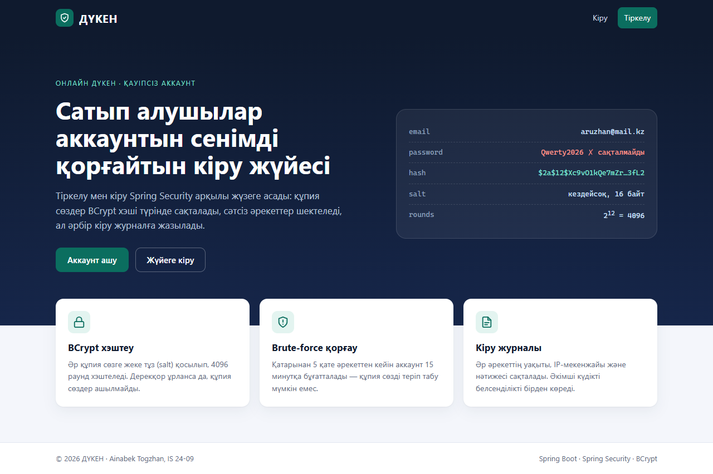
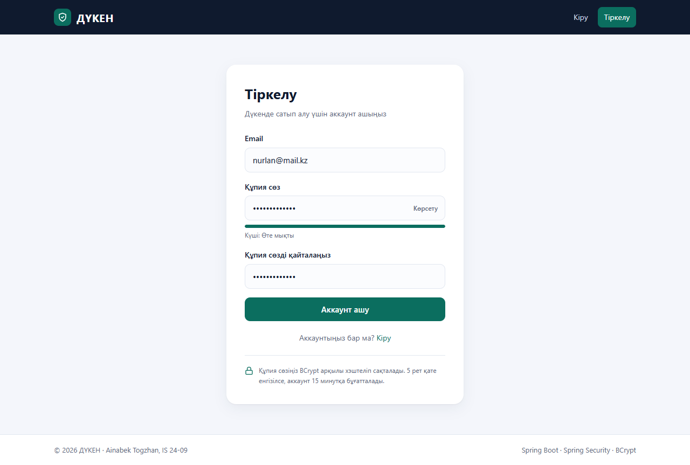
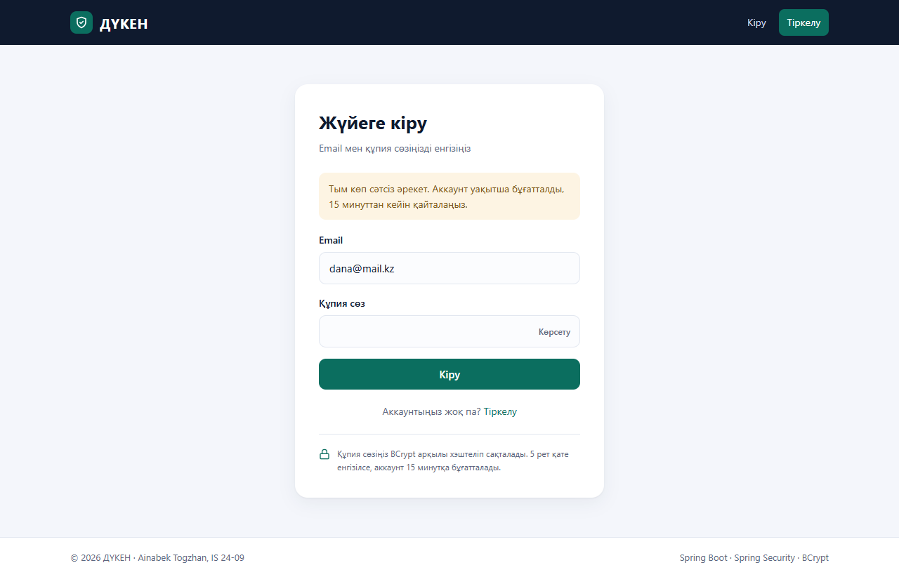
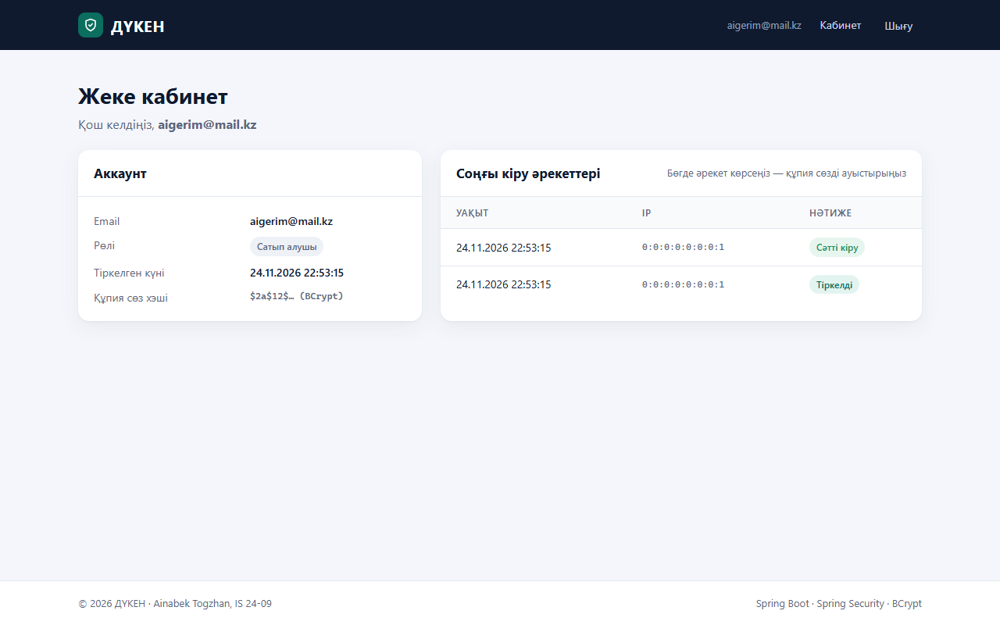
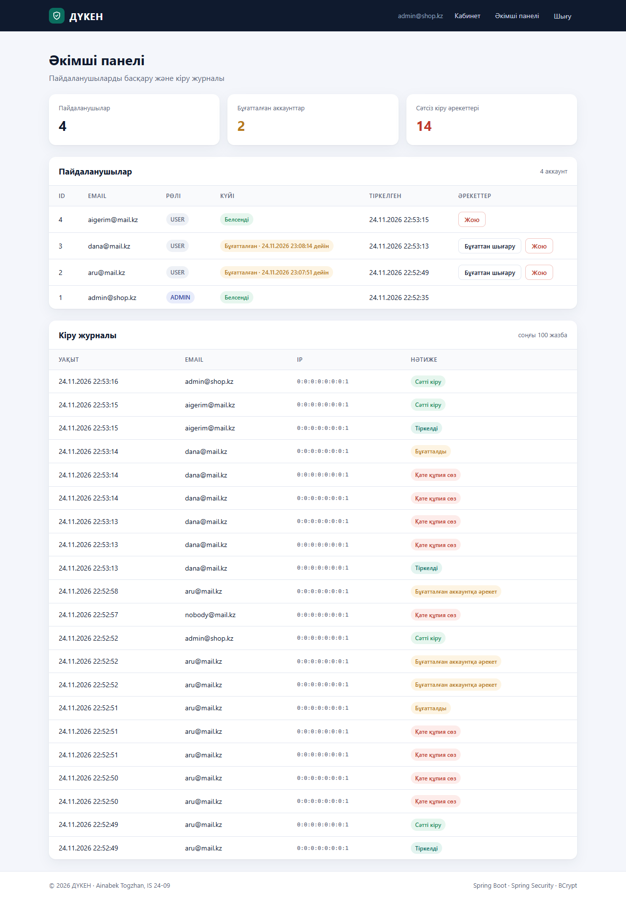
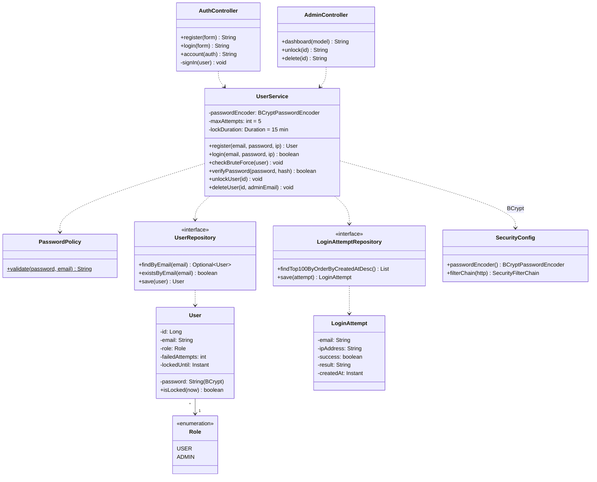
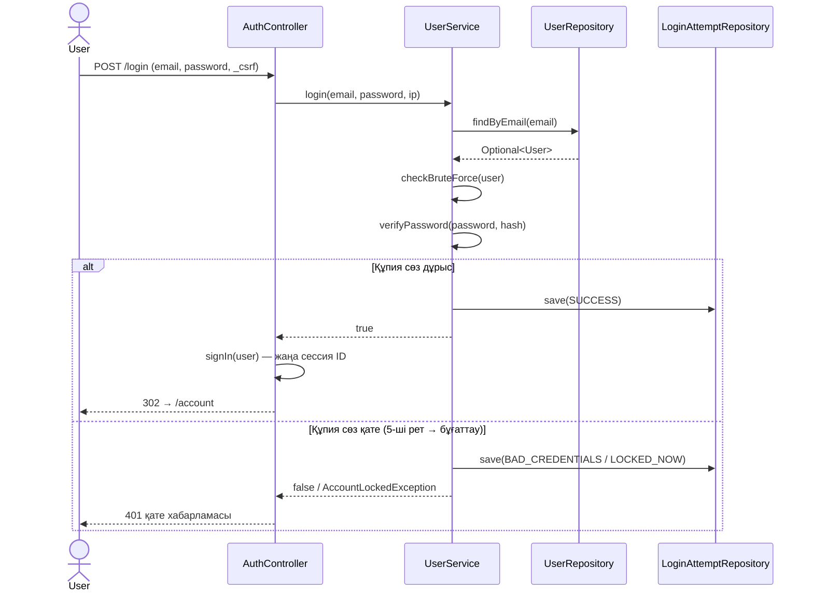

# Онлайн дүкен үшін қауіпсіз тіркелу/кіру жүйесі

**Автор:** Ainabek Togzhan · **Топ:** IS 24-09 · **Пән:** Компьютерлік қауіпсіздік (6-тақырып)

   



## Мақсаты

Онлайн дүкен пайдаланушыларын қауіпсіз тіркеу және жүйеге кіргізу. Жоба келесі қауіптерден қорғайды:

| Қауіп | Қорғау тәсілі |
|---|---|
| Дерекқор ұрланса, құпия сөздердің ашылуы | **BCrypt** (strength 12 = 4096 раунд, әр құпия сөзге жеке кездейсоқ тұз) |
| Құпия сөзді теріп табу (brute-force) | Қатарынан **5 қате** → аккаунт **15 минутқа** бұғатталады |
| Күдікті әрекетті байқамау | Әр әрекет **журналға** жазылады: уақыт, email, IP, нәтиже |
| Email-дің бар-жоғын анықтау (user enumeration) | Бірдей хабарлама «Email немесе құпия сөз қате» + жоқ email үшін де BCrypt тексеруі (timing attack) |
| CSRF шабуылы | Әр POST формасында CSRF токен (Spring Security) |
| Session fixation | Кіргеннен кейін сессия ID-і жаңартылады |
| XSS / clickjacking | Thymeleaf автоматты экрандау, `Content-Security-Policy`, `X-Frame-Options: DENY` |
| SQL-инъекция | Spring Data JPA параметрленген сұраныстары |
| Әлсіз құпия сөздер | Кемінде 8 таңба, әріп + сан, жиі кездесетін сөздер тізімі, BCrypt-тің 72 байт шегі |
| Кодтағы құпия деректер | Әкімші құпия сөзі мен БД паролі тек орта айнымалыларынан; `.env` — `.gitignore`-да |

## Технологиялар

Java 17+, Spring Boot 3.5, Spring Security 6, Spring Data JPA, Thymeleaf, H2 (әдепкі) / PostgreSQL, JUnit 5, Mockito, Maven.

Криптография стандартты JCA арқылы: `java.security.SecureRandom` (тұз және әкімші құпия сөзін генерациялау) + Spring Security `BCryptPasswordEncoder`. Өз алгоритміміз ойлап табылмаған.

## Орнату және іске қосу

Қажет: **JDK 17 немесе одан жоғары**. Maven орнатудың қажеті жоқ — жобада Maven Wrapper (`mvnw`) бар.

```bash
git clone <repo-url>
cd TOGZHAN_AUTH

# Windows
set ADMIN_PASSWORD=ӨзіңіздіңМықтыҚұпияСөзіңіз1
mvnw.cmd spring-boot:run

# Linux / macOS
ADMIN_PASSWORD='ӨзіңіздіңМықтыҚұпияСөзіңіз1' ./mvnw spring-boot:run
```

Браузерде ашыңыз: **http://localhost:8080**

> `ADMIN_PASSWORD` орнатылмаса, жүйе кездейсоқ әкімші құпия сөзін генерациялап, консольге **бір рет** шығарады. Әкімші email-і: `admin@shop.kz` (`ADMIN_EMAIL` арқылы өзгертуге болады).

### PostgreSQL-мен іске қосу

```bash
export DB_URL=jdbc:postgresql://localhost:5432/shop DB_USER=shop DB_PASSWORD=...
./mvnw spring-boot:run -Dspring-boot.run.profiles=postgres
```

### Тесттер

```bash
./mvnw test
```

32 тест: 13 unit-тест (`UserServiceTest`), 8 тест (`PasswordPolicyTest`), 11 интеграциялық тест (`AuthFlowIntegrationTest` — HTTP → Controller → Service → H2).

## Қолдану мысалы

1. **Тіркелу** — `/register`: email және мықты құпия сөз енгізіңіз (индикатор күшін көрсетеді).
2. **Кіру** — `/login`: сәтті кірсеңіз, жеке кабинетке өтесіз, онда соңғы кіру әрекеттеріңіз көрінеді.
3. **Brute-force тексеру** — құпия сөзді 5 рет қате енгізіңіз: аккаунт 15 минутқа бұғатталады, дұрыс құпия сөз де қабылданбайды.
4. **Әкімші панелі** — `/admin` (`admin@shop.kz`): пайдаланушылар тізімі, бұғаттан шығару, жою және кіру журналы.

| Тіркелу | Бұғатталған аккаунт |
|---|---|
|  |  |

| Жеке кабинет | Әкімші панелі |
|---|---|
|  |  |

## Жоба құрылымы

```
src/main/java/kz/onlineshop/auth/
├── config/       SecurityConfig (BCrypt, CSRF, рөлдер, CSP), DataInitializer (әкімші)
├── controller/   AuthController (тіркелу, кіру, кабинет), AdminController
├── dto/          RegisterForm, LoginForm
├── model/        User, Role, LoginAttempt
├── repository/   UserRepository, LoginAttemptRepository
└── service/      UserService (бизнес-логика), PasswordPolicy, ерекшеліктер
src/main/resources/templates/   Thymeleaf беттері
src/test/java/                   JUnit 5 тесттері
docs/uml/                        PlantUML диаграммалары (.puml)
```

## UML

PlantUML бастапқы файлдары: [`docs/uml`](docs/uml) (класс, прецедент, тіркелу мен кірудің тізбек диаграммалары). Төменде GitHub автоматты түрде салатын қысқаша нұсқасы берілген.

### Класс диаграммасы



### Кіру тізбегі (Login)



## Қауіпсіздік ескертпесі

- Бұл — оқу жобасы. Өндірісте (production) міндетті түрде **HTTPS** қосыңыз және cookie үшін `server.servlet.session.cookie.secure=true` қойыңыз.
- Бұғаттау аккаунт деңгейінде жүреді. Шабуылдаушы әдейі бөтен аккаунтты бұғаттай алады (DoS) — өндірісте оған қоса IP бойынша шектеу және CAPTCHA қосқан жөн.
- IP-мекенжай `request.getRemoteAddr()` арқылы алынады; `X-Forwarded-For` тақырыбына әдейі сенбейміз, өйткені оны клиент жалған қоя алады.
- Құпия сөздер, токендер мен `.env` файлдары репозиторийге түспейді (`.gitignore`). Журналда құпия сөздің өзі ешқашан сақталмайды.
- H2 веб-консолі қауіпсіздік үшін өшірілген.

## Лицензия

[MIT](LICENSE) © 2026 Ainabek Togzhan
